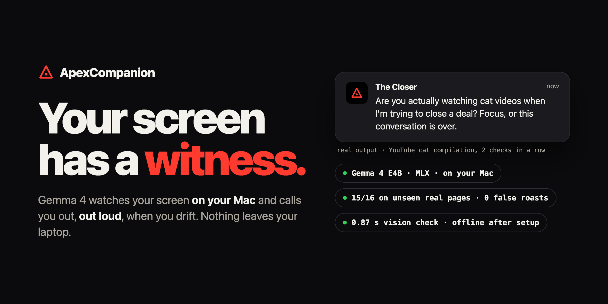
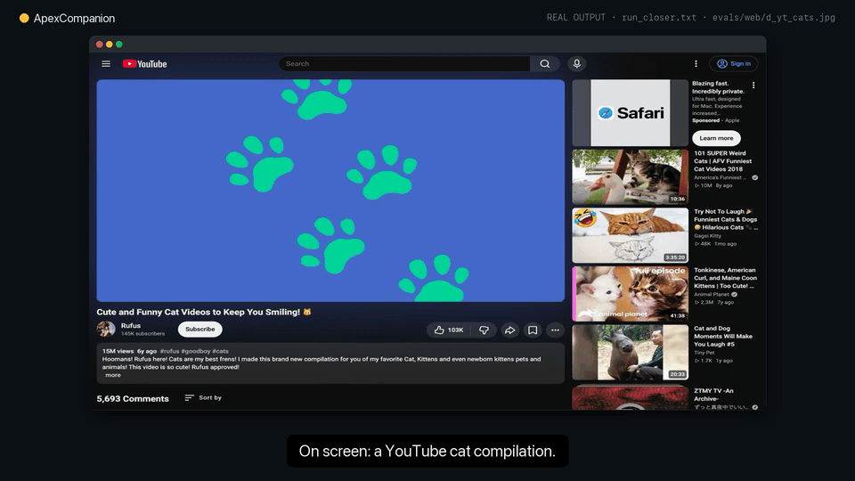

<p align="center">
  
</p>

<p align="center">
  <a href="https://github.com/kgorle1111/ApexCompanion/releases/latest"></a>
  
  
  <a href="LICENSE"></a>
  <a href="https://kgorle1111.github.io/ApexCompanion/"></a>
</p>

# ApexCompanion

**A focus coach that watches your screen with Gemma 4, on your laptop, and says it out loud when you drift.**



Demo video and landing page: https://kgorle1111.github.io/ApexCompanion/

## Download

1. Download **ApexCompanion.zip** from [Releases](https://github.com/kgorle1111/ApexCompanion/releases/latest).
2. Unzip it and drag **ApexCompanion** into Applications.
3. Open it. macOS warns you because the app is not notarized: click **Done**, then go to **System Settings → Privacy & Security** and click **Open Anyway** (first time only; on macOS 15 and later, right-click → Open no longer gets you past this).
4. Pick your coach.

Step-by-step install and permissions guide: [INSTALL.md](INSTALL.md).

**Requirements:** Apple Silicon Mac (M1 or later), macOS 14 or newer, 24 GB of RAM recommended (measured peak footprint 11.3 GB, so a 16 GB Mac works but swaps with a browser and editor open; 8 GB is not recommended), and about 12 GB of free disk (setup plus the 8.3 GB model; the launcher wants 10 GB still free after setup). First run needs internet: it downloads uv, Python with about 850 MB of packages, and the model. After that it makes no network calls.

It has no window: it talks through notifications. Open the app again to stop it, switch coach, or edit your sites. It speaks out loud and names what's on your screen, so mute your Mac (or run from source with `--mute`) in shared spaces.

Built for watching yourself: no accounts, no remote reporting. Install it only on your own Mac.

Developers can also [run it from source](#run-from-source).

## What it does

Every 10 seconds it checks what you're doing. If one of your site rules matches the frontmost app or the browser tab's URL, that decides. Otherwise Gemma 4 describes a screenshot and code decides whether you're working. Two distracted checks in a row and your coach speaks up: a one- or two-line roast, in character, that names what you're actually looking at. While you work, it stays quiet.

Nothing leaves the machine while it runs. Once setup is done, pull the Wi-Fi and it keeps running.

> Think of it as a gym coach who can see your screen but has signed an NDA with your laptop.

---

## Why local

A screenshot of your screen is about the most private data you have: your messages, your bank tab, your half-written cover letter. Sending one to a cloud API every 10 seconds is not a reasonable thing to ask anyone to accept.

So the model runs on the laptop: Gemma 4 E4B, 8-bit, through `mlx-vlm` on Apple Silicon. `HF_HUB_OFFLINE=1` keeps the Hugging Face client off the network, and `gemma.py` sets it by default too.

What stays on disk:
- **Screenshots: nothing.** Each frame goes to one temp file, gets classified, and is deleted right after its check.
- **Session log:** one local, text-only `session-*.jsonl` file per session, readable only by you (`chmod 600`). Each check records the category and verdict, the frontmost app name, the browser tab's host (not the full URL), which of your rules matched, and any line it spoke. The model's screen description is kept only for checks where a roast fired. Delete `~/Library/Application Support/ApexCompanion/logs` (app) or `./logs` (source) anytime.

Side effects of running locally: it's free, and after setup it works on a plane.

## How it works

```
 every 10 s
 ┌───────────────┐   ┌──────────┐   ┌──────────────────────┐   ┌──────────────────┐
 │ screencapture │──▶│ sips     │──▶│ Gemma 4 E4B (vision) │──▶│ code maps        │
 │ -x -t jpg     │   │ -Z 1024  │   │ JSON: app, content,  │   │ category → state │
 └───────────────┘   └──────────┘   │ category             │   │ working /        │
                                    └──────────────────────┘   │ distracted       │
         screenshot deleted after the check                    └────────┬─────────┘
                                                                        │
             bad JSON or unknown category ──▶ "working" (never roast on garbage)
                                                                        │
                          distracted 2 checks in a row AND 60 s cooldown passed?
                                                                        │ yes
                                    ┌──────────────────────┐   ┌────────▼─────────┐
                                    │ macOS notification   │◀──│ Gemma 4 (text)   │
                                    │ + `say` (spoken)     │   │ ≤2-sentence roast│
                                    └──────────────────────┘   │ names app+content│
                                                               └──────────────────┘
 Ctrl-C ──▶ session stats: length, checks, % focused, call-outs
```

Before the vision call, your site rules check the frontmost app and the active tab's URL. On a rule hit, the vision model is skipped for that check (see [Your sites, your rules](#your-sites-your-rules)).

One model load, reused for both the vision call and the roast. The same Gemma 4 weights do both jobs.

Category map (lives in code, not in the prompt):

| Category | State |
|---|---|
| `coding`, `docs_reading`, `notes_writing`, `educational_video`, `messaging`, `news_reading`, `other` | working |
| `entertainment_video`, `social_media`, `shopping`, `gaming`, `feed_browsing`, `sports` | distracted |

Messaging, news, and "other" count as working on purpose. A false roast while you're replying to your professor is worse than a missed one. The prompt also tells the model to ignore ads, banners, and pop-ups, so a sidebar ad doesn't decide the category.

Trade-off to know about: "other" fails open to working. A native game that lands in "other" won't be roasted, unless you put it on your list (next section).

### Your sites, your rules

The model's guess is a default, not the last word. You keep a plain-text list, `sites.txt`, created on first run, with two sections:

```
[distracting]
reddit
steam
[ok]
github
figma
```

- One site or app per line. Not case-sensitive, whole-word match, `#` starts a comment.
- **"ok" always wins.** If something matches both sections, it counts as working.
- Edits apply on the next check. No restart.
- What it matches against: only the frontmost app's name and, for Safari, Chrome, Arc, Brave, and Edge, the URL of the active tab (macOS asks once to let ApexCompanion control your browser; it reads only the tab's address, locally). In Firefox and other browsers, only the app name. It never matches on-screen text, so a page can't trip or dodge a rule by what it displays.
- That means rules work by domain or app, not by YouTube channel: allow a site or an app, not one channel on it.
- Only the address counts, not the search box: googling "reddit" is not a visit to reddit.
- Firefox exposes no tab address, so site rules don't work there; app-name rules (like `steam` or `firefox` itself) still do.
- Built in: `youtube.com/shorts` always counts as distracting. Your `[ok]` list still wins.
- On a rule hit, the vision model is skipped for that check.
- A rule changes the verdict, not the timing: it still takes 2 distracted checks in a row before a roast.

The design point: your list is deterministic and overrides the model both ways, so a wrong guess about your own sites is something you fix in one line, not something you argue with.

### Personas

Two original archetypes, not impressions of any real person or character, picked with `--persona`:

- **The Closer** (`--persona closer`): an arrogant, razor-witty dealmaker who treats you like the associate about to blow the deal.
- **The Whip** (`--persona whip`): a cold, slow-talking political operator who speaks in unsettling metaphors.

Each persona is a prompt, a few example lines, and a built-in macOS voice, in `personas.py`. Repeat offenses escalate: the second call-out in a session is sharper than the first, and from the third on it counts out loud. Stay on task long enough (30 working checks in a row by default) and you get a rare line of praise. Every spoken line passes a word filter: if a line contains a slur or injected instructions, it's replaced with a fixed safe line.

## Design decision: the model never says "distracted"

The first version asked Gemma one question: is this screenshot `working` or `distracted`? It labeled a YouTube cat compilation "working". Gemma 4 did it, and so did Gemma 3 when we tried it as a cross-check.

A binary label gives the model room to rationalize ("maybe they're researching cats"). So we split the job:

1. **The model describes.** It returns `{"app", "content", "category"}`: which app, what's on screen, and one category from a fixed list.
2. **Code decides.** A lookup table maps the category to working or distracted. The model never emits the verdict.

With describe-then-categorize, the same cat video landed in a distracted category, so the code called it distracted.

That fix started as **one synthetic test case**. The real-page eval came after: on a blind batch of 23 real public web pages captured after tuning, the classifier got **15/16 clear-cut pages right** (Wilson 95% interval about 72% to 99%), with **0 false roasts on clear-cut pages** (details under [Evaluating it](#evaluating-it)).

It's the pattern we default to: deterministic guards around one structured model call, and code owns the final decision. The debounce, cooldown, and fail-open default are plain Python (`Coach` in `apex.py`, no I/O) with unit tests in `tests/`. Your site list (`rules.py`) works the same way: plain code, checked before the model call, which it skips on a hit.

## Prior art (and what's different)

We're not the first to point a local model at a screen to catch drift. [AccountyCat](https://github.com/strjonas/AccountyCat) is an MIT macOS focus companion running local Qwen via llama.cpp; it reads the app and window title first and uses a screenshot only when that's ambiguous, then nudges you. [Observer AI](https://github.com/Roy3838/Observer) lets you build local screen-watching agents, including "when I'm distracted, call me". Dayflow keeps a local screenshot timeline without intervening.

What ApexCompanion does differently:
- **Gemma 4 vision on every check your own rules don't already decide**, not window-title text with a screenshot fallback.
- **Spoken persona roasts** that name what's on screen, instead of a quiet nudge.
- **Code owns the verdict.** The model describes; a lookup table decides.

The trade-off is real: a text-first design like AccountyCat's is cheaper on compute and battery than running a vision model every 10 seconds.

## Run from source

Requires an Apple Silicon Mac (MLX), Python 3.12, and [uv](https://docs.astral.sh/uv/).

```bash
uv venv --python 3.12
uv pip install mlx-vlm pillow
```

Download the model once while you're online (it goes into the Hugging Face cache):

```bash
.venv/bin/python -c "from huggingface_hub import snapshot_download; snapshot_download('mlx-community/gemma-4-e4b-it-8bit')"
```

Grant screen access: **System Settings → Privacy & Security → Screen Recording**, enable your terminal app, then quit and reopen it. Without this, screenshots come back as just your wallpaper and everything looks like "other", so the coach would silently stay quiet. `apex.py` checks for this and refuses to start without the permission. It also warms the model at boot, so the first real check isn't slow.

Run:

```bash
HF_HUB_OFFLINE=1 .venv/bin/python apex.py --persona closer
```

Swap `closer` for `whip` to change the voice. Turn your volume up. Ctrl-C ends the session and prints your stats.

Useful flags: `--interval` (seconds between checks, default 10), `--streak` (distracted checks before a roast, default 2), `--cooldown` (seconds between roasts, default 60), `--praise-every` (0 turns praise off), `--mute`, `--once` (one check, print, exit), `--image FILE` (classify a file instead of the screen; repeatable), `--sites FILE` (path to your site list; defaults to `sites.txt` next to `apex.py`).

## Measured numbers

Measured on an M3 Max, `mlx-community/gemma-4-e4b-it-8bit`, `mlx-vlm 0.7.10`, offline.

| What | Number | Caveat |
|---|---|---|
| Model load | **3.4 to 3.7 s** | |
| First classify call | **2.6 s** | includes warm-up |
| Vision classify call only, warm | **p50 0.87 s, p95 0.96 s** (batch 1); **p50 0.78 s, p95 0.94 s** (batch 2) | model already loaded; excludes `screencapture` and resize |
| Roast generation | **0.57 to 0.79 s** | |
| Peak memory | **11.3 GB** footprint | `/usr/bin/time -l` over a 306-check soak; steady state 8.6–8.9 GB, no growth seen in 5 min |
| End-to-end check | 2 distracted checks → spoken roast | worked once, on a synthetic image |
| **Batch 2, blind** (23 pages, never tuned on) | **15/16** clear-cut (Wilson 95% interval about 72% to 99%), **21/23** overall, 0 false roasts on clear-cut pages | the headline; captured after prompt tuning finished; labels not reviewed by a person |
| Batch 2 distracted recall, clear-cut | **6/7** | exactly at the 0.85 gate |
| Batch 1, tuning set (28 pages, used while tuning) | **25/25** clear-cut, **26/28** overall | not a fair test on its own |
| Both batches pooled | **40/41** clear-cut across 51 pages (95% interval lower bound about 87%); distracted recall **17/18** | secondary; one false roast, on a page labeled ambiguous |
| Real-world time from opening a distraction to the roast | not measured yet | by design at least 2 checks at a 10 s interval, plus 0.6 to 0.8 s to write the roast |
| Battery drain per hour | not measured yet | |

Fixed settings (configuration, not measurements): 10 s check interval, 2 consecutive distracted checks before a roast, 60 s cooldown between roasts, screenshots downscaled to 1024 px on the long side.

## Evaluating it

`eval.py` runs the classifier over real screenshots in `evals/` against hand labels (`evals/labels.json`, `evals/labels2.json`) and prints accuracy and per-case latency. The repo has the labels and results (`evals/results*.json`), but not the screenshots: they're captures of third-party pages, so they're git-ignored. That means you can't rerun the eval from the repo alone.

Pages a reasonable person could call either way are labeled ambiguous and reported separately. All runs: Gemma 4 E4B 8-bit, `mlx-vlm 0.7.10`, M3 Max, offline.

**Batch 2 (the headline): 23 pages, blind.** Captured after prompt tuning had finished, and never used to tune anything. The labels are provisional: they have not been reviewed by a person yet.
- Clear-cut pages: **15/16** (Wilson 95% interval about 72% to 99%), with **0 false roasts on clear-cut pages**.
- All 23 pages: **21/23**.
- Distracted recall: **6/7**, exactly at the 0.85 gate.
- Misses: a YouTube Shorts basketball clip filed as `educational_video` (a clear-cut distraction it let through), and a celebrity-gossip page (Page Six) filed as `news_reading` (labeled ambiguous). Both failed open to working.
- Vision classify latency: p50 0.78 s, p95 0.94 s, warm.

**Batch 1 (the tuning set): 28 pages, used while tuning the prompt.** Real public web pages captured in a headless browser: 12 working, 11 distracted, 5 hard cases. The author confirmed every label. Because we tuned on it, it's not a fair test on its own.
- Clear-cut pages: **25/25**.
- All 28 pages: **26/28**. Both misses were ambiguous cases: a lofi "study" stream whose player showed "Video unavailable", and a random Wikipedia biography. The lofi stream was called distracted: that is the one false roast in the eval, on a page labeled ambiguous.
- Distracted recall: **11/11**.
- Vision classify latency: p50 0.87 s, p95 0.96 s, warm.

**Pooled:** 40/41 clear-cut across 51 real pages (95% interval lower bound about 87%). That is a small set, not a general accuracy figure.

**Checking that the eval can fail.** We broke the category map on purpose and re-ran it (mutation testing). Moving `entertainment_video` into the working list turned the eval red on the distracted-recall gate (threshold 0.85). Moving `coding` into the distracted list turned it red with 6 false roasts. The first version of the gate checked accuracy only, and it did not catch the first mutation, so we added the recall gate.

## Logs and observability

Everything stays on your Mac. Each session writes one owner-only JSON Lines file (`logs/` when run from source, `~/Library/Application Support/ApexCompanion/logs/` for the app). Files older than 7 days are deleted at startup (`--log-days`).

Every line carries a session id, a schema version and an event:

| Event | What it records |
|---|---|
| `session_start` | persona, interval, cooldown, replay or screen mode, Python and macOS versions |
| `model_ready` | model id, load time, memory |
| `check` | verdict, category, rule hit, site host (never the full address), per-stage timing (`rules`, `capture`, `classify`, `roast`, `total`), whether the word filter replaced the line; screen text only when a roast fired |
| `error` | which stage failed (`rules`, `capture`, `classify`, `roast`) and the error; the session keeps going |
| `session_end` | checks, roasts, errors, focus %, duration, peak memory |

To read it:

```bash
.venv/bin/python report.py            # latest session
.venv/bin/python report.py --all      # every session
.venv/bin/python report.py --json     # for scripts
```

The report shows focus %, roasts, how often a site rule decided the check, how often the word filter fired, error and unparsed-output rates, and p50/p95 for each stage. The app shows the same summary when you stop it. This is also where real end-to-end latency comes from: the 0.87 s figure above is the classify step alone, and `total` in a live session includes the screenshot.

## Limitations

- **Web pages only.** The eval is 51 real web pages captured in a headless browser. No native-app frames (VS Code, the terminal, the native Spotify app, games) and no real desktop frames were tested. Your site list can cover a native app by name.
- **Fail-open categories hide misses.** Anything filed under "other", or misfiled into a working category, counts as working and is never roasted. In the blind batch, a Shorts clip went to `educational_video` and a Page Six gossip page to `news_reading`. The built-in Shorts rule now covers the first case in supported browsers.
- **Small eval, one labeler.** 16 blind clear-cut cases is a small set; one miss is about 6 points. The labeler is the author, and batch-2 labels have not been reviewed by a person.
- **Not reproducible from the repo.** Labels and results are committed; the screenshots are not (third-party pages).
- **Heavy for a background app.** 11.3 GB peak memory footprint, and a vision call every 10 seconds. Expect trouble on Macs with little unified memory, and expect it to cost more battery than a text-first approach.
- **Mac only.** `screencapture`, `sips`, `osascript`, `say`, and MLX are all macOS / Apple Silicon.
- **It sees one screen, once every 10 seconds.** It can miss short distractions, and on multiple displays it only judges what `screencapture` captures.
- **Context is a single frame.** A lecture on YouTube with a cat thumbnail in the sidebar, or gameplay footage you're watching for work, can be misread. Fail-open defaults and the 2-check debounce reduce false roasts; they don't eliminate them.
- **The session log is a record of what you looked at.** Text only, local, readable only by you, but it includes app names and site hosts. Delete the logs folder if you don't want it.
- **Spoken roasts name what's on screen.** Anyone nearby hears it. Use `--mute` (or mute your Mac) in shared spaces.
- **Rules are word matches.** A rule like `news` matches any app name or tab URL containing that word. Keep entries specific.
- **It's a nudge, not a blocker.** It won't stop you from opening anything. That's deliberate, but it means it only works if you leave it running.
- **No automatic fallback.** The Ollama build of Gemma 4 we had takes no image input, which is why vision runs through `mlx-vlm`. Gemma 3 vision via Ollama worked in a quick test, but that path isn't wired into `apex.py`.

## License

MIT for the code in this repo. The Gemma 4 weights are distributed by Google under their own terms; check the model card before redistributing them.
